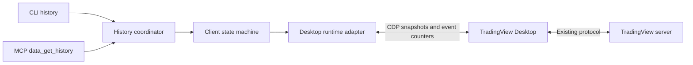
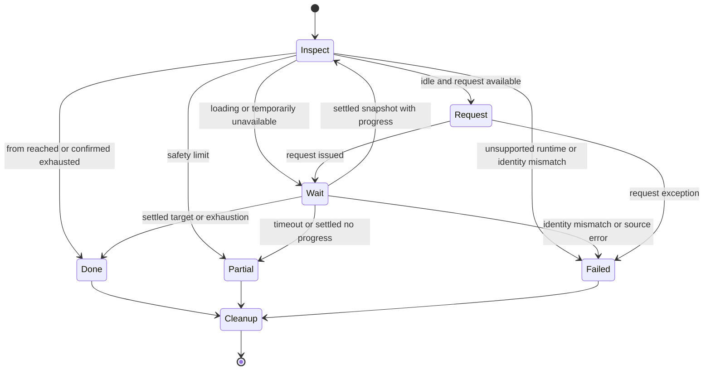

# History Early Stop System Design

Status：`implemented`。狀態機、runtime adapter、整合與 Desktop 驗收已完成。
依據 [驗證結果](./VERIFICATION.md)，以 TradingView Desktop 現有訊號建立 client
狀態機，讓 history 的完整性回報反映已確認的結果。

## Boundary and scope

只修改本 repository 的 client。Desktop 與 server 的協定、排程及資料來源不變。
不以攔截 server 通訊推斷結果，不突破商品／帳戶可用歷史範圍。

涵蓋 CLI 與 MCP 共用的 history core、錯誤呈現、單元測試及針對性 Desktop 驗證。
沿用日期篩選、去重、排序、筆數／請求上限、檔案輸出及圖表切換／還原。
不修改 watchlist、不重構其他 chart paging、不新增 MCP 的 to schema，
也不新增 timeout CLI flags；本次將 timeout 設為有測試替身的內部政策。

## Signals and trust

| Desktop 訊號 | Client 用途 | 限制 |
| --- | --- | --- |
| isLoading() | 區分目前是否仍在載入 | 缺失／例外是 unknown，不得轉成 false。 |
| endOfData()、endOfDataType() | 確認來源宣告耗盡 | 本次只確認 true＋type=end；載入期間可能保留前次值。 |
| dataEvents().completed()、onDataLoaded() | 完成通知、促使重讀結果 | 不包含我們可依賴的 server request ID，不能只憑事件宣告成功。 |
| dataEvents().error() | 記錄本次觀察到的來源錯誤 | 錯誤 payload 尚未驗證；不得猜測可重試或當作耗盡。 |
| requestMoreDataAvailable() | 決定當下是否允許送出新請求 | false 不等於耗盡；true 也不等於一定有更舊資料。 |
| first_time | 判斷向過去載入是否有進展 | 最新 bar 更新或總筆數變多不足以證明向過去進展。 |

isCompleted()、數值 status 與私有 _lastCompleteFlags 只保留在既有驗證結論，
不作 production 判斷依據。requestMoreData 的同步回傳或 Promise resolve
都只代表呼叫返回，仍須驗證資料狀態。

## Components

| 元件 | 責任 |
| --- | --- |
| src/core/data.js | 保留 getHistory 公開入口、共用 chart data lock、參數驗證、切換／還原與輸出組裝。 |
| src/core/history-runtime.js（新增） | 隔離 Desktop API、能力檢查、短 CDP 呼叫、事件訂閱、來源身分與 observer 清理。 |
| src/core/history-loader.js（新增） | 純 client 狀態機、deadline、分頁、資料進展、區間收集與停止原因；透過注入 runtime 測試。 |
| src/core/history-errors.js（新增） | 用現有 CoreOperationError 表達 history 空區間、未完成、timeout、來源變更與清理失敗。 |
| src/cli/commands/data.js | 沿用 options／輸出；驗證標準錯誤呈現及部分結果行為。 |
| src/tools/data.js | history handler 使用既有 coreErrorResult，避免吞掉 code／retryable。其他工具不變。 |

## State machine

每次呼叫同時最多一個由本 loader 發出的未確認請求。訂閱先於請求建立，事件只更新
observer 的計數與錯誤狀態；Node 每 250 ms 讀取一致 snapshot，以事件及實際狀態判斷。
這避免以長時間 CDP awaitPromise 等待資料，也避免事件回呼內重入分頁流程。

狀態機管理的是「client 能確認的進度」，不是 server 的內部狀態。
只有 loading=false 時才接受 settled 完成判斷。endOfData=true 且 type=end
代表來源回報耗盡；不要求 more=false，因為實測到達起點時 more 仍可能為 true。

## Result contract

| 情境 | complete | stop_reason／錯誤 |
| --- | --- | --- |
| 已到達 from，且未裁掉要求範圍內資料 | true | from_reached |
| 已確認來源耗盡 | true | no_more_data |
| 筆數或請求上限 | false | max_bars／max_requests |
| 完成但沒有向前進展，未確認耗盡 | false | no_progress |
| 單次等待／整體讀取 deadline 到期 | false | load_timeout／history_timeout（新增） |
| snapshot 暫時不可讀，等待期限已到 | false | read_failed |
| 已確認空區間 | 無成功結果 | HISTORY_RANGE_EMPTY，不可重試 |
| 尚未確認完整，且目前沒有區間內資料 | 無成功結果 | 原因對應的 typed error，不誤報空區間 |
| 來源身分改變、CDP／來源錯誤 | 無成功結果 | typed error；不混入其他商品資料 |

有部分資料時 success=true 沿用現有契約，complete=false 才表示未完整；CLI 不因此
改 exit code，output 仍可寫出部分資料。既有 metadata／bars 格式不變。
新增 stop reasons 與錯誤 code 需在 README／help 說明，呼叫端不可將未知原因當作完整。

## Deadlines and recovery

已實作政策：poll interval 250 ms、每次等待 10 s、整體資料操作 120 s。
這些是工程政策，不是依 100～250 ms 的實測推導出的服務保證。
使用 monotonic clock；新資料或雜訊事件不會無限延長同一次等待期限。

逾時只表示 client 停止等待，不代表 Desktop 請求被取消。這次修正不自動重送載入請求；
retryable=true 是允許呼叫端稍後重試，不保證重試成功。新操作必須先檢查既有 loading，
不得在上一個 Desktop 請求仍執行時重疊發送。

不增加全域／跨 process 鎖。現有 chart data lock 僅保護同 process 的相關資料操作；
來源參照與商品／週期檢查用來偵測外部改動，不能宣稱全面防止共用 Desktop 的所有競態。

## Cleanup and ownership

所有成功、部分完成、錯誤與逾時都進入 finally：先關閉 observer，再按 restore_chart
還原本次確實修改的商品／週期，最後釋放鎖。no-restore 也必須清除 observer。
如果使用者已將 pane 切到其他商品，不覆蓋該外部變更，回報來源衝突。

事件 listener 必須可解除，且 page observer 有 lease，避免 client 中斷後永久殘留。
清理／還原失敗不可假裝成功；保留主因並以結構化錯誤回報。
viewport 的保存／還原是 live 測試手法；正式 history 不新增 viewport mutation。

## Compatibility and delivery

必要狀態方法不支援時 fail closed，回報 HISTORY_RUNTIME_UNSUPPORTED。
事件訂閱不可用時允許有期限的狀態輪詢；缺失訊號不得推成耗盡。
endOfDataType 的未驗證值不視為 end，回報不完整的 unsupported_end_state。

先以單元測試驗證時序、生命週期及錯誤契約，再以 TAIEX 跨初始範圍、6902 上市邊界
驗證。同時保留既有 history、CLI、MCP 與錯誤契約測試。
實作順序與驗收分工見 [tasks](./README.md#tasks)，細節見 [LLD](./LLD.md)。
